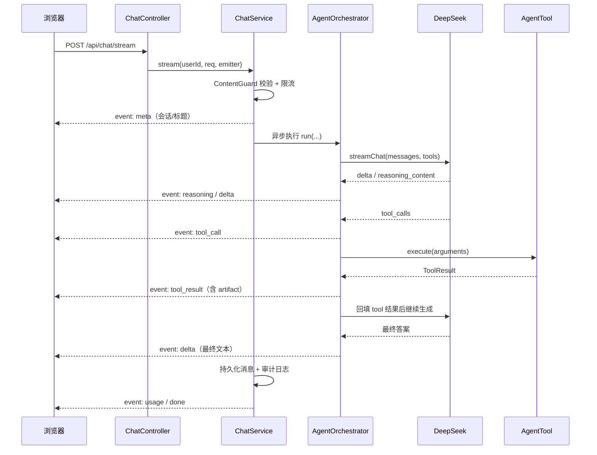

# 系统架构设计

## 1. 总体架构

智学引擎采用前后端分离 + 单体分层架构：前端是纯静态 SPA（构建后由 Spring Boot 直接托管），后端是分层清晰的 Spring Boot 单体，数据库为 MySQL。单体形态降低了参赛演示的部署成本，同时通过**模块化包结构 + 接口隔离**保证可演进性。

```
┌───────────────────────────── 浏览器 ─────────────────────────────┐
│  Vue 3 SPA                                                       │
│  ├─ views/       6 个路由页面（懒加载）                            │
│  ├─ components/  设计系统组件（按钮/卡片/图表/思考面板/引用列表）     │
│  ├─ stores/      Pinia（auth / ui / toast）                      │
│  └─ api/         fetch 封装 + SSE 解析器                          │
└───────────────┬──────────────────────────────┬───────────────────┘
                │ JSON (REST)                  │ text/event-stream (SSE)
┌───────────────▼──────────────────────────────▼───────────────────┐
│  Spring Boot 3.5                                                 │
│                                                                  │
│  web 层      Controller（Auth/Chat/Knowledge/Quiz/Plan/Analytics）│
│  安全层      AuthInterceptor → JwtService → UserContext           │
│  service 层  ChatService / QuizService / PlanService / ...        │
│  agent 层    AgentOrchestrator + ToolRegistry + 4 个 AgentTool     │
│  llm 层      DeepSeekClient（流式、工具、多模态、降级）              │
│  rag 层      Tokenizer / TextSplitter / KnowledgeIndex / Extractor │
│  repo 层     Spring Data JPA（11 个实体）                          │
└───────────────┬──────────────────────────────────────────────────┘
                │ HikariCP
┌───────────────▼──────────────────────────────────────────────────┐
│  MySQL 8.x（utf8mb4）                                             │
└──────────────────────────────────────────────────────────────────┘
                │ HTTPS
          DeepSeek V4.1 API
```

### 分层职责

| 层 | 职责 | 关键约束 |
| --- | --- | --- |
| Controller | 参数校验、鉴权取用户、组织响应 | 不写业务逻辑，统一返回 `ApiResult` |
| Service | 领域编排、事务边界 | 不直接拼 HTTP；跨领域通过 Service 调用 |
| Agent | 决策循环、工具调度、事件推送 | 不感知 HTTP，事件通过 `AgentEventSink` 抽象 |
| LLM | 与模型通信、SSE 解析、增量聚合 | 对上层只暴露 `LlmResult`，异常统一为 `LlmException` |
| RAG | 解析 → 切片 → 向量 → 检索 | 索引可失效重建，检索结果必须可溯源 |
| Repository | 数据访问 | 复杂查询用 JPQL 投影，避免 N+1 |

---

## 2. 模块与关键类

```
com.zhixue.engine
├── config       AppProperties / DeepSeekProperties / WebConfig / AsyncConfig / HealthController
├── common       ApiResult / BusinessException / ApiExceptionHandler / Json
├── security     JwtService / AuthInterceptor / UserContext / PasswordService
├── user         User / UserRepository / AuthService / AuthController / AuthDtos / UserView
├── llm          DeepSeekClient / LlmResult / LlmListener / LlmException / StructuredGenerator
├── agent        AgentOrchestrator / AgentTool / ToolRegistry / PromptLibrary / AgentEventSink / AgentResult
│   └── tools    KnowledgeSearchTool / QuizTool / StudyPlanTool / LearningReportTool
├── rag          Document / DocChunk / DocumentExtractor / TextSplitter / Tokenizer
│                KnowledgeIndex / KnowledgeService / KnowledgeController / KnowledgeSeeder
├── chat         Conversation / Message / ChatService / ChatController / ChatDtos
├── quiz         Quiz / QuizQuestion / QuizService / QuizController / QuizDtos
├── plan         StudyPlan / StudyTask / PlanService / PlanController / PlanDtos
├── analytics    LearningEvent / AiUsageLog / AnalyticsService / AnalyticsController / AnalyticsDtos
└── safety       ContentGuard / RateLimiter
```

### 关键设计取舍

1. **SSE 而非 WebSocket**：对话是"一问一答 + 单向流式"，SSE 语义更贴合，且可复用 HTTP 鉴权与 Tomcat 线程模型。
2. **独立线程池**：`agentExecutor`（core 8 / max 32 / queue 64）承接 AI 长任务，Web 线程立即返回 `SseEmitter`，避免占用容器线程。
3. **Agent 与传输解耦**：`AgentEventSink` 定义 `onReasoning/onContent/onToolCall/onToolResult/onCitations`，Controller 侧实现为 SSE 推送，未来换 WebSocket 只需换实现。
4. **检索索引内存化**：切片向量持久化在 MySQL，DF/IDF 统计在内存中按用户构建并缓存，文档变更时精准失效（`invalidate(userId)`）。

---

## 3. 数据模型

11 张表（统一 `zx_` 前缀，避免与他人数据库中的同名表冲突），按领域分组：

```
zx_users ──┬─< zx_conversations ──< zx_messages
           ├─< zx_documents ──< zx_doc_chunks
           ├─< zx_quizzes ──< zx_quiz_questions
           ├─< zx_study_plans ──< zx_study_tasks
           ├─< zx_learning_events
           └─< zx_ai_usage_logs

zx_documents(user_id IS NULL) = 公共示例知识库，所有用户可见
```

| 表 | 说明 | 关键字段 |
| --- | --- | --- |
| `zx_users` | 账号与学习画像 | `password_hash`(BCrypt)、`level`、`learning_goal` |
| `zx_conversations` / `zx_messages` | 会话与消息 | `reasoning`、`tool_trace`(JSON)、`citations`(JSON)、`tokens` |
| `zx_documents` / `zx_doc_chunks` | 知识库与切片 | `sparse_vector`（稀疏词权重 JSON）、`keywords` |
| `zx_quizzes` / `zx_quiz_questions` | 测验与题目 | `options`(JSON)、`answer`、`is_correct` |
| `zx_study_plans` / `zx_study_tasks` | 计划与任务 | `day_index`、`status`、`minutes` |
| `zx_learning_events` | 学习行为事件 | `type`、`knowledge_point`、`score`、`minutes` |
| `zx_ai_usage_logs` | AI 调用审计 | `scene`、tokens、`latency_ms`、`blocked` |

> 建表脚本 [`db/schema.sql`](../src/main/resources/db/schema.sql) 全部使用 `CREATE TABLE IF NOT EXISTS`，随应用启动幂等执行。

---

## 4. 核心流程

### 4.1 流式对话（Agent 多步循环）



**终止条件**（三重保护）：模型不再请求工具 / 达到最大步数 4 / 客户端断开（`cancelled`）。若步数耗尽仍无文本，追加一次不带工具的收尾调用。

### 4.2 知识入库（RAG Ingestion）

```
上传文件 → DocumentExtractor（PDFBox / UTF-8 文本）
        → TextSplitter（句末断句，480 字符 / 80 重叠）
        → Tokenizer（中文单字 + bigram，英文分词，去停用词）
        → 稀疏向量 {term: 1+ln(tf)} → JSON 存 doc_chunks
        → KnowledgeIndex.invalidate(userId)  // 下次检索重建索引
```

### 4.3 混合检索

对给定 query：

1. 分词 → 稀疏向量 → 乘 IDF 后 L2 归一化
2. 每个切片：`cosine`（IDF 加权点积）+ `coverage`（query 词 IDF 命中占比）
3. `score = (0.62·cosine + 0.38·coverage) × lengthPenalty`
4. 取 top `4×K`，用 **MMR(λ=0.78)** 选出最终 K 条，兼顾相关性与多样性
5. 返回 `RetrievalHit`（文档标题 / 段落号 / 片段 / 分数）→ 前端渲染为引用

### 4.4 测验提交

```
提交答案 → 逐题判分（大小写无关）
        → 更新 quiz(status=DONE, score)
        → 写入 learning_events（整体 1 条 + 每个知识点 1 条，答对 100 / 答错 40）
        → LLM 生成学情诊断（失败自动降级为规则化文案）
        → 返回逐题解析 + 薄弱知识点
```

---

## 5. 非功能性设计

### 性能

| 措施 | 效果 |
| --- | --- |
| 路由级代码分割（`import()`） | 首屏 JS ≈ 123KB（gzip 48KB），Tutor 页按需加载 |
| SSE 流式渲染 | 首字延迟从"等待完整答案"降到 ~1s |
| HikariCP 连接池（max 12） | 避免并发下的连接建立开销 |
| 检索索引内存缓存 | 同一用户重复检索不再解析 JSON |
| Gzip 压缩（JSON/HTML/CSS/JS） | 传输体积下降 60%+ |
| 静态资源内容哈希 + 长缓存 | 二次访问命中浏览器缓存 |

### 可靠性

- LLM 调用失败 → `LlmException` → 全局异常处理器返回 502 + 友好文案
- 结构化生成失败 → **自动降级到备用模型**，再失败才报错
- 工具执行异常 → 错误信息回填给模型，由模型自行纠正后继续
- 学情诊断失败 → 规则化兜底文案（不影响批改结果）

### 安全

| 风险 | 措施 |
| --- | --- |
| 密钥泄露 | 全部走环境变量；`.env` 被 `.gitignore` 排除 |
| 越权访问 | 所有资源查询强制 `userId` 归属校验 |
| XSS | `marked` 渲染结果经 `DOMPurify` 白名单净化 |
| 提示词注入 | 规则检测 + 系统提示词降权指令 + 不泄露系统提示 |
| 滥用 | 每用户 60s 滑动窗口限流（默认 24 次/分钟） |
| 审计 | 每次模型调用写入 `ai_usage_logs`（场景/模型/tokens/耗时/状态） |

### 可扩展性

- **新增 Agent 工具**：实现 `AgentTool` 并声明为 Bean，`ToolRegistry` 自动注册，工具定义自动注入模型请求
- **替换模型**：`DeepSeekClient` 走 OpenAI 兼容协议，改 `base-url` / `model` 即可切换供应商
- **替换向量后端**：`KnowledgeIndex` 是唯一检索入口，替换为 pgvector / Milvus 不影响上层
